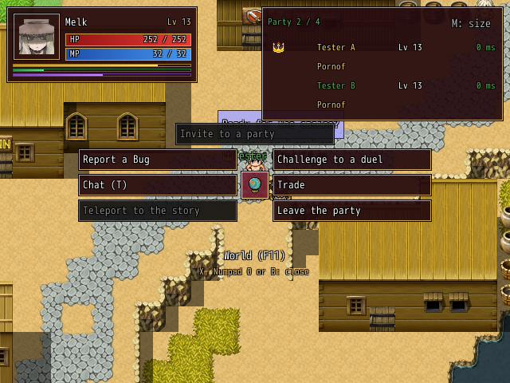
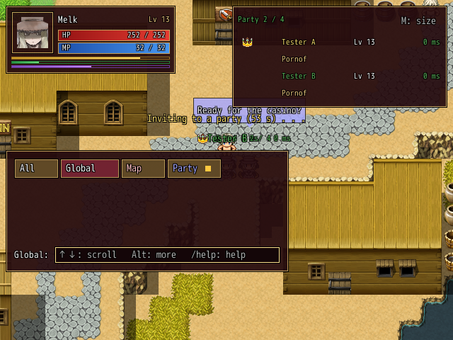
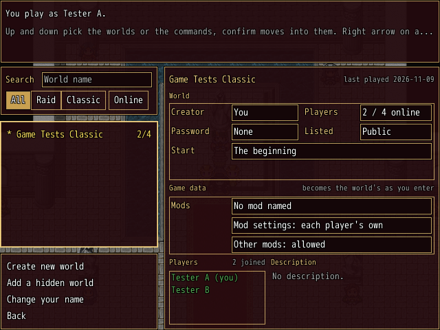
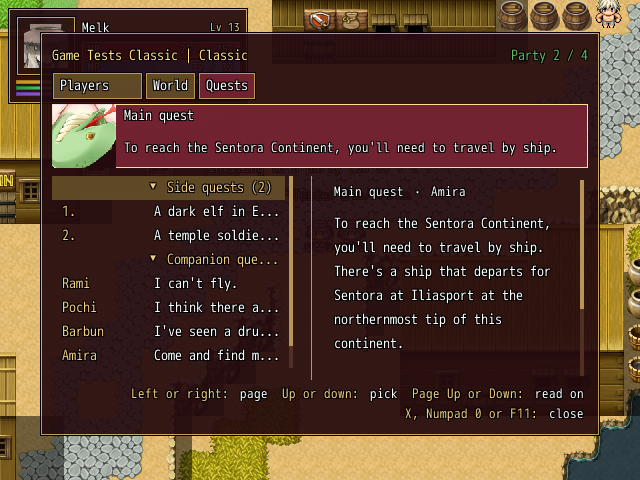

# Monster Girl Quest! Online

*An unofficial multiplayer mod for Monster Girl Quest! Paradox RPG.*

Play Monster Girl Quest! Paradox RPG together with friends over the internet, with nothing to set up in your router.

  
  
  
  

- **Worlds:** up to 32 players on the same maps, with emotes and an overview of everyone online and of your quests under way: the main quest, Amira's side quests and your companions' requests. A world is *Classic*, where each party plays its own story, or a *Raid World*.
- **Raid Worlds:** the whole world plays one story together, party or not. Everyone on a map watches its scenes, battles pull in the nearest players, and each story boss is one fight the whole world wears down, which waits where it beat you. A player behind catches up as they level, with up to ten times the experience.
- **Raid bosses everywhere:** a Classic world, or single player through *Options → Mods → MGQ Online SP*, can make the story bosses raid bosses of their tier, with their HP bars and without any connection in single player.
- **Chat:** global, map, party and whisper chats in tabs, a gold dot on tabs with unread lines, and speech bubbles over the players on your map.
- **Turn off other mods:** a world can be played with its own mods and nothing else. Entering it loads only the world's mods, and yours come back when you leave the world.
- **Parties:** up to four players play the leader's story together and share one team's worth of companions. Teleport to any party member once they allow it, or to the leader at once.
- **Co-op battles:** party members on the same map join each other's battles, each commanding their own characters.
- **Duels:** your team against a friend's, live, inside a world.
- **Trading:** swap items, equipment, stones and gold with a player on your map; a disconnect never loses or copies anything.
- **World mods:** a world names the mods it needs, in the versions its creator has, and entering it installs them from the [website](https://mgqonline.org/mods) through the Mod Framework.
- **Your interface:** the mod is drawn by the Mod Framework and wears its look, and every box of the mod moves and resizes while you hold the left **Alt**. The Leader HUD and the World overview show your characters' pictures.

Worlds, Raid Worlds, parties and co-op battles are a **prototype**: expect bugs, and please [report them](https://github.com/Pauliinchen/MGQ-Online/issues/new?template=bug_report.yml).

## Requirements

- **Monster Girl Quest! Paradox RPG 3.06** on Windows, or on Linux with Wine or Proton, untranslated or with the English or Russian translation. Everyone needs the same game version and the same version of this mod. A translated and an untranslated game can play together; each shows battles in its own language. The mod does not run on JoiPlay.
- **The community's mod loader:** the `Patch.rb` from [*Patch.rb (enable Type 1 mods)*](https://mgq.miraheze.org/wiki/Paradox_mods#Patch.rb_(enable_Type_1_mods)) on the MGQ wiki, in your `Patch` folder. The Russian translation brings its own `Patch.rb`, which loads the mod too: keep it and skip the wiki one.
- **The [Mod Framework](https://github.com/Pauliinchen/MGQ-Mod-Framework)** 0.1.0 or later, from the [website](https://mgqonline.org/mods): the mod runs on it, and it installs and updates the mod. The mod's settings and hotkeys are in its *Options → Mods*. Without it the game says so as it starts, and the mod stays off.

Optional:

- [Discord Rich Presence](https://github.com/Pauliinchen/MGQ-Paradox-Discord-Rich-Presence) 1.5.1 or later: show on your profile who you're playing with and use your Discord name in worlds. With 1.6.1 or later you also invite friends into your world, password included.
- [Battle Dialogue](https://github.com/Pauliinchen/MGQ-Paradox-Mod-Collection/tree/main/Battle_Dialogue): shows what characters say in boxes at the screen's sides, so nobody waits for another player to press a key.

## Install

1. Install the Mod Framework first: download it from the [website](https://mgqonline.org/mods), close the game and extract it into the folder that contains `Game.exe`. You then have `!Mod_Framework.rb` and a `Mod_Framework` folder in your `Patch` folder.
2. Install *Monster Girl Quest! Online* with the Mod Framework: start the game and find it in *Browser* in the Mods box of the title screen. Or download `MGQ-Online-<version>.zip` from the [latest release](https://github.com/Pauliinchen/MGQ-Online/releases/latest), close the game and extract the zip into the folder that contains `Game.exe`.

You then have `Multiplayer.rb` in your `Patch` folder, and next to it a `Multiplayer` folder with the rest of the mod; your name and worlds go there too. The logs go into the `Logs` folder of the game folder.

While the mod is installed, the game keeps running when its window is in the background. A gamepad does nothing meanwhile.

**Update:** the mod has no updater of its own; the Mod Framework updates it like any mod of the website. When the server needs a newer release, *Multiplayer* on the title screen asks for it, as does the title after the server turned your version away in a world; until then worlds, duels and trades stay off. *Update and restart* installs the release and starts the game again in the Multiplayer menu. Your name, hotkeys, favourites and worlds are kept. If the game cannot start after an update, download the release again and extract it over the old one. This is checked on Windows; under Wine and Proton it should work too but is not checked yet: if the update does not move into place there, close the game and extract the release's zip into the game folder by hand.

**Coming from 0.6:** install the Mod Framework 0.1.0 first, from the [website](https://mgqonline.org/mods) or its [GitHub release](https://github.com/Pauliinchen/MGQ-Mod-Framework/releases), then MGQ Online 0.7 as above; 0.6 can no longer play online. On Windows, 0.6.9.2 offers the update itself as you pick *Multiplayer*, but it brings 0.7 without the framework: the game then says MGQ Online needs the Mod Framework, and the mod stays off until you install it. Under Wine and Proton, 0.6.9.2 cannot update itself: close the game, install the framework, extract the 0.7 zip into the game folder by hand and delete `Patch\0_ModConfigRemake.rb`, which 0.6 brought and the framework replaces.

**Uninstall:** close the game and delete `Multiplayer.rb` and the `Multiplayer` folder in `Patch`. Keep `Patch\Multiplayer\Worlds` if you want to play your worlds again later. The Mod Framework stays for your other mods.

## Quick start

1. Pick **Multiplayer** below *Continue* on the title screen and type the name the others see.
2. One of you picks *Create new world*, gives it a name, picks *Classic* or *Raid* (fixed once created) and, if you like, a password.
3. Everyone confirms on that world and picks *Enter the world*.
4. On the map, stand next to a friend, press **B** and pick *Invite to a party*; they accept in their own wheel. You now play the leader's story together and fight co-op battles. In a Raid World everyone plays the world's story, and a party gets the first places in battles.

## Hotkeys

| Hotkey | What it does |
|---|---|
| **B** | Action wheel: invite, duel, trade, chat, report a bug, teleport to the leader (other members from the World overview) |
| **T** | Chat: **/g** everyone, **/m** your map, **/p** your party, **/w** one player, **/help** |
| **E** | Emote wheel |
| **F11** | World overview, in a world and in single player |
| **Y** / **N** | Accept / decline the first invite among the notices, or answer a question box |
| **M** | Make the party box small or full; in a raid boss battle, shrink the boss's HP bar to the bars alone or back |
| **H** | Make the Leader HUD at the top left small or large |
| **J** | Join the battle of a player next to you in a Raid World, fight a raid boss alongside a full boss battle, or fight a raid boss again where it beat you |
| **F3** | Report a bug, with a screenshot and your logs, anywhere but the title and game over screens |

Rebind them in *Options → Mods → MGQ Online Hotkeys*, Y and N in *Mod Framework Hotkeys*. The mod's settings are in *Options → Mods → MGQ Online Settings*, those for single player in *MGQ Online SP*.

## Documentation

- [Player guide](docs/GUIDE.md): worlds, parties, co-op battles, duels and trading in full, and [troubleshooting](docs/GUIDE.md#troubleshooting).
- World types: [Classic Worlds](docs/CLASSIC_WORLDS.md), where each party plays its leader's story, and [Raid Worlds](docs/RAID_WORLDS.md), with the world's story, catching up and every raid boss.
- [Developer notes](docs/DEVELOPER.md): building, testing and how the mod works inside.
- [Relay](Relay/README.md): the server the games meet at, and its protocol.
- [Battle server](BattleServer/README.md): the game's own battles played on the server, without Game.exe.

## Disclaimer

Monster Girl Quest! Online is an unofficial fan project. It is not affiliated with or endorsed by Torotoro Resistance, the creators of Monster Girl Quest!, or the English translation team. It contains no game or translation files.
