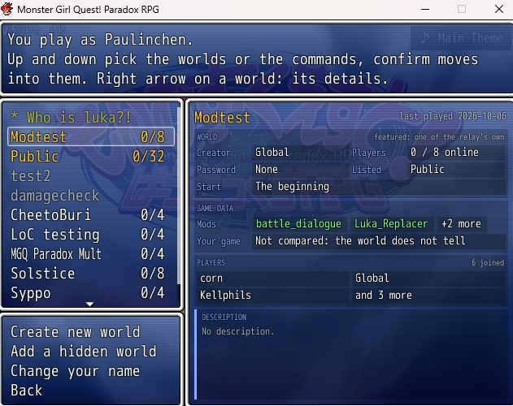
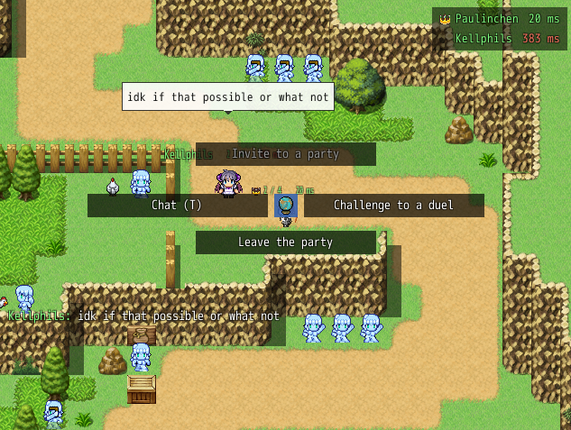
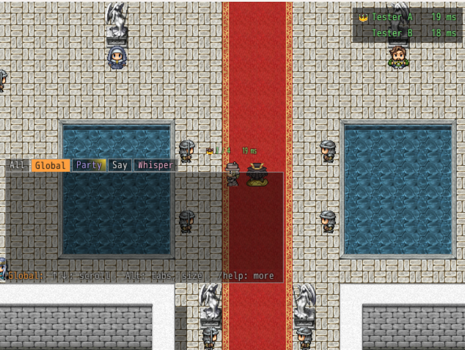
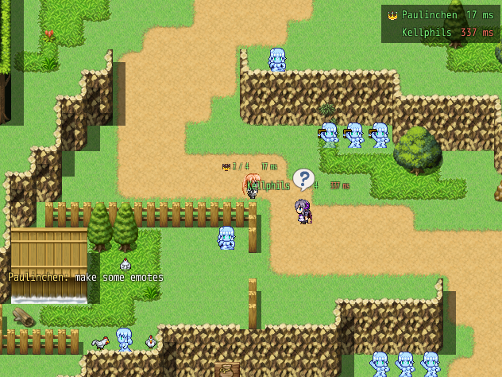
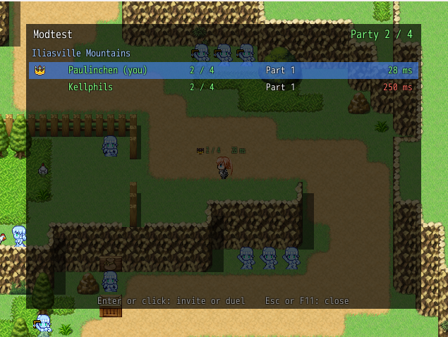
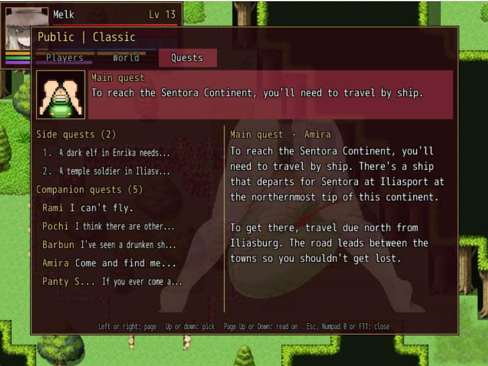
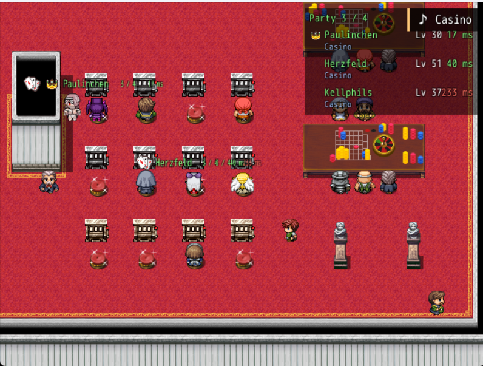
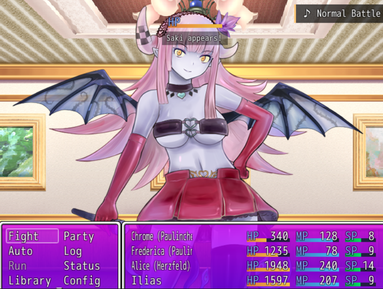

# Player guide

Everything Monster Girl Quest! Online does, for players. To install the mod, see the [README](../README.md).

- [Hotkeys](#hotkeys)
- [Interface](#interface)
- [Single player](#single-player)
- [Worlds](#worlds)
- [On the map](#on-the-map)
- [Parties](#parties)
- [Co-op battles](#co-op-battles)
- [Duels](#duels)
- [Trading](#trading)
- [PvP battles](#pvp-battles)
- [Rules of every multiplayer battle](#rules-of-every-multiplayer-battle)
- [Connection and privacy](#connection-and-privacy)
- [Troubleshooting](#troubleshooting)

## Hotkeys

| Hotkey | What it does |
|---|---|
| **B** | Opens the action wheel. |
| **T** | Opens the chat. |
| **E** | Opens the emote wheel. |
| **F11** | Opens the World overview, or the PvP battle screen outside a world. |
| **Y** / **N** | Accepts / declines the first invite in the notification box, and answers a question box (see [Notifications](#notifications)). |
| **Tab** | Makes the party box small or full. In a raid boss battle, shrinks the boss's HP bar to the bars alone, without its title and the names, or back. |
| **H** | Makes the Leader HUD at the top left small or large (see [Interface](#interface)). |
| **J** | Joins the battle of a player next to you in a Raid World, fights a raid boss alongside a full boss battle, or fights a raid boss again where it beat you, while the prompt below your character shows. |
| **F3** | Opens the bug report, with a screenshot taken at the press. Works anywhere but the title and game over screens: in a menu it opens at once, in a battle after the battle, and on a busy map once you're free. |

This guide names the default hotkeys. To bind others, open *Mod Config → MGQ Online Hotkeys*, confirm the hotkey's row (*Action Wheel*, *Chat*, *World Overview*, *Accept Notification*, *Decline Notification*, *Emote Wheel*, *Party Box Size*, *Leader HUD Size*, *Join Battle* or *Report a Bug*) and press the new key; **Esc** keeps the old one.

- Keys the game uses itself can't be bound: the arrows, Enter, Space, Esc, Z, X, Shift, Ctrl, A, S, D, Q, W, Page Up, Page Down, numpad 0, 2, 4, 6 and 8, F1, F2, F5 to F9 and F12. Neither can a key another hotkey already uses.
- Your hotkeys are kept in `Patch\Multiplayer\Player.ini`, so they hold in every save and every world, and the texts in the game name the hotkeys you bound.

## Interface

**Look.** *Mod Config → MGQ Online Settings → Interface Look* sets the colors of every box, frame and window of the mod:

- **Monarch** (the default): dark maroon with a gold edge in a black rim, gold titles and dark gold tabs, the look of the raid boss bar.
- **Legacy**: black glass with a thin grey edge and grey tabs, the look the mod had before.

The raid boss bar's red HP stays red in both.

**Scrolling.** The mouse wheel scrolls the list or text it points at: the world list and its choices, the players, mods and description boxes, the mod picker, the trade offers and your bag, the open chat log (three rows a notch), a description you type, and every page of the World overview. A thin scrollbar shows beside each of them while it holds more than fits.

**Moving and resizing.** Hold the left **Alt** and every box of the mod you can move gets a white outline with its name, and the screen names the controls at its bottom:

- Drag inside a box to move it.
- Drag its edge or corner to resize it. Some boxes only change their width, since their height follows what they show.
- Double-click a box to put it back where it starts.

**Leader HUD.** On the map, the top left shows your Formation Leader: their name and level, their HP and MP, and three thin bars with how far they are to their next base, job and race level. It shows in single player too.

- *Mod Config → MGQ Online Settings → Leader HUD* turns it **On** (the default) or **Off** inside worlds; *MGQ Online SP → Leader HUD* does the same in single player.
- *Leader HUD Size* picks **Large** (the default), with their face and the numbers inside the HP and MP bars, or **Small**, with their map sprite and the bars alone. **H** switches between them on the map.
- Hold the left **Alt** and drag it to move it, like the other boxes.
- It hides while a message shows at the top of the screen. The map's name, a medal just won and the notification box move below it while it sits at the top left.

The boxes you can move: the chat (on the map and in battles, each its own place), the Leader HUD, the notification box, the party box, the world status lines, the World overview, the raid boss bar, the waiting box of a co-op battle, the question and message boxes, and the list box of the world screen. Things that follow a character (names, bubbles, wheels, the bar above a raid boss) stay with it.

- A box never gets smaller than it needs to show everything it holds, and never leaves the screen.
- While **Alt** is held, the mouse only moves and resizes; clicks don't reach the boxes.
- *Mod Config → MGQ Online Settings → Interface Positions* says *Moved* while any box is moved; pick *Default* to put every box back.
- The look and the places are kept in `Patch\Multiplayer\Player.ini`, so they hold in every save and every world, and a world that sets its mods' options never changes them.

## Single player

Outside a world, the world features (chat, players, parties, trading) stay hidden, and what follows needs no connection. *Mod Config → MGQ Online SP* holds it:

- **Leader HUD:** the [Leader HUD](#interface) in single player, **On** or **Off**; until you set it, it follows *MGQ Online Settings → Leader HUD*.
- **Raid Bar on Map** and **Raid Bar in Battle:** the raid bosses' HP bars above the boss on the map and across the top of the battle, each **On** (the default) or **Off**. They count in single player and in Classic Worlds with raid bosses; a Raid World always shows both.
- **Raid Bosses:** **On** lets the story bosses fight as raid bosses of their tier, far stronger, exactly as in a [Classic World with raid bosses](CLASSIC_WORLDS.md#raid-bosses). **Off** (the default) keeps them as the game has them.

They are kept in `Patch\Multiplayer\Player.ini`, so they hold in every save.

**Restart.** After you change one of them while playing outside a world, the map asks whether to start the game again so they apply cleanly, as soon as nothing runs there and the game would let you save. *Restart* saves your game apart from your save slots (`Patch\Multiplayer\Resume.rvdata2`), starts the game again and goes on right where you were; nothing is lost and no slot is touched. *Later* keeps playing; the settings apply anyway. Under Wine or Proton the game closes and you start it again yourself; it still goes on where you were. Should that game ever fail to load, it is kept as `Patch\Multiplayer\Resume <date>.rvdata2` and a message names it.

## Worlds

Pick **Multiplayer** below *Continue* on the title screen. The first time, the game asks for the name the others see, unless the Discord mod knows yours. Names and passwords are typed on the keyboard; with a gamepad, the game's letters appear.

Each world keeps its own saves, Library, medals and affection in `Patch\Multiplayer\Worlds`, so your own game stays untouched. Going back to the title screen leaves the world.

### World types

Every world is one of two types, chosen when it's created and fixed from then on. Each has a page of its own:

- **[Classic Worlds](CLASSIC_WORLDS.md):** each party plays its leader's story; outside a party you play your own.
- **[Raid Worlds](RAID_WORLDS.md):** the whole world plays one story together, party or not, and each story boss is one fight the whole world wears down.

This guide covers what works in both, and says in a line where a type changes it.

### The world screen

The left side has two boxes: the worlds, and below them the commands (*Create new world*, *Add a hidden world*, *Change your name*, *Back*). Up and down pick a box, confirm moves into it and cancel moves back out, so the commands are reached without scrolling through a long list. Cancel with a box picked leaves the screen.

**Your name** is the one the others see: your name on Discord, until you choose one in *Change your name*, typed in place at the right; **Enter** keeps it. Without Discord and without a name, the world screen asks for one when it opens. The last name Discord told stands in while Discord is still connecting, such as right after a restart.

The worlds box lists every public world, the hidden worlds you joined and the hidden worlds you added by their id, in this order:

1. the Raid Worlds, in red, even above your favourites; a featured Raid World is red rather than gold;
2. your favourites, marked `*`;
3. the featured worlds in gold, which the relay's admins run;
4. the ones you played last.

Worlds you played that the relay no longer lists, such as one its creator deleted, come last.

With the cursor on a world, the right side shows its details: who made it, its password (*None*, *Needed*, or *Known* once this PC entered it with the password), its players, how new players start, the mods it needs, whether your game data matches the creator's, and its description. The right arrow moves into the details; up and down pick the mods, *Your game*, the players or the description, and confirm (or a click) opens the full list or text. Every player who ever joined is listed, those online first. The left arrow or cancel goes back to the list.

### Entering a world

Confirm on a world and pick *Enter the world*.

- Type its password the first time, unless it has none; your game remembers it after that.
- You continue from your latest save in that world. The first time, you start at the opening or from the creator's save, or choose where to start if the creator lets you. A save can run code on your PC, so take a creator's save only from creators you trust: before taking it, the game warns you and offers *Take*, *Start at the beginning* or *Back*.
- A world is only entered once the list has loaded, since the list tells what the world asks of your game.
- **Through Discord** (with the Discord mod): while you play in a world, friends can be invited through the **+** in a Discord chat or ask to join from your profile. Accepting starts their game if it's closed and enters the world from the title screen, without its password; a friend in the middle of a game is told to go back to the title screen. Discord offers no invite while the party it shows is full.

### Creating a world

*Create new world* opens a form at the right. Creating a world does not enter it: it appears in the list, marked as a favourite, the cursor lands on it ("\<name> was created. Confirm to enter it.") and you enter it from there.

| Field | What it does |
|---|---|
| Name | What the list shows. |
| Password | Left empty, anyone may enter. |
| Max Players | 2 to 32. |
| Hidden | Leaves the world out of the list. Only its players see it, and whoever adds it by its id. |
| World type | *Classic* or *Raid*, see [World types](#world-types). Fixed once created. |
| Sharing companions | Raid World only: whether the companions one player has come to the others, see [Creating a Raid World](RAID_WORLDS.md#creating-a-raid-world). Fixed once created. |
| Shared save | Every new player starts from one of your saves instead of the opening; in a Raid World the world's story starts there too. Choose the save after ticking it. |
| Player's choice | Classic World only: each new player chooses where to start when they first enter, see [Starting out](CLASSIC_WORLDS.md#starting-out). |
| Raid Bosses | Classic World only: the story bosses fight as raid bosses of their tier, far stronger, without shared HP, see [Raid bosses](CLASSIC_WORLDS.md#raid-bosses). |
| Difficulty | Raid World only: the difficulty every player plays on, see [Creating a Raid World](RAID_WORLDS.md#creating-a-raid-world). |
| Mods | The mods of the world, picked from a list of yours. See [Mods of a world](#mods-of-a-world). |
| Allow data mismatch | Unticked at first: a game whose data differs from yours can't enter. Ticked, it is warned and may enter anyway. See [Game data](#game-data). |
| Shared Mod Settings | Ticked: every player in the world plays with your options of its mods. Unticked: each keeps their own. See [Mods of a world](#mods-of-a-world). |
| Turn off other mods | While a player is in the world, their mods the world doesn't name are off. Ticked at first for a Raid World, unticked for a Classic one, until you tick or untick it yourself. See [Turning off other mods](#turning-off-other-mods). |
| Description | What the world is about, up to 1000 characters. |

The creator can change Max Players, Mods, *Shared Mod Settings*, *Turn off other mods*, the Description, a Raid World's Difficulty and a Classic World's *Raid Bosses* later with *Edit the world*. Everything else is fixed once the world exists.

### Managing worlds

- **Hidden worlds:** the creator copies the id with *Copy the world id* and sends it. The others pick *Add a hidden world* and type or paste it (Ctrl+V); **Enter** adds it, and the cursor lands on the world in their list ("\<name> was added to your list. Confirm to enter it."). *Remove from my list* takes it off again as long as you never entered it. Your game keeps the 50 worlds you added last.
- **Favourites:** *Mark as a favourite* puts a world at the top of your list.
- Your favourites and the hidden worlds you added are kept in `Patch\Multiplayer\Player.ini`.
- **Taking a save home:** *Copy my latest save to my game* on a world you've played, or *Copy to my game* in the menu while you're in it, copies that world's latest save into the first free slot of your own saves. Your own Library, medals and affection stay as they are.
- **Deleting your saves:** *Delete my saves of it* removes your saves of a world from this PC. You'd start anew there, and need its password again.
- **The creator** can remove a player, who can then no longer enter, or delete the world for everyone. The relay's admins can edit and delete any world.

### Mods of a world

*Mods* in the create or edit form opens a list of the mods in your `Patch` folder, all unlisted at first. The mod loader, this mod and Mod Config Remake aren't in it, since every player has them.

- **Enter** or a click on a mod lists or unlists it. *List all your mods* at the top lists every one at once, and then *Unlist all your mods* unlists them again.
- Each mod has two buttons at the right, under the columns *Required* and *Essential*, reached with the right arrow or a click: the red **!** makes it required, the orange **?** essential. A filled button shows how a mod is named; pressing it again makes the mod only listed.

| Mod is | Meaning |
|---|---|
| Listed | Only tells the players; keeps nobody out. |
| Required | A game needs a script `Name.rb` in its `Patch` folder, in the world's version, to enter. Case, spaces, underscores and hyphens don't matter. Shows first: green when you have the world's version, gold when yours is another, red when you don't have it. |
| Essential | For mods that are data files without a script. Keeps nobody out by itself; green while your game data matches the world's, gold otherwise. |

- *Add a mod by name* names a mod you don't have yourself, such as a mod of data files: its row becomes a text box, **Enter** adds the name you typed, **Esc** or numpad **0** goes back. Such a mod stays in the list when unlisted; **Del** removes it.
- The mods take 16,000 characters at most, far more than any real list; the top right of the list says when a change would pass that. **Esc** or numpad **0** goes back to the form, which shows them as the world keeps them: `!` in front of a required mod, `?` in front of an essential one.

The details show each mod in a box of its own, as many as fit the row, and count the rest in a last box.

**Same version for everyone.** The relay keeps a catalog of mods its admins added, with each one's current version.

- When you enter a world, each required mod is compared with the catalog. If one is missing or another version, the world screen says which and offers *Download and restart*: it fetches the world's version, checks every file, puts it into your `Patch` folder, restarts the game and enters the world. Under Wine or Proton the game cannot restart itself: close it and start it again, and it enters the world. *See the mods* lists your version and the world's.
- A required mod the catalog doesn't know is compared with the creator's copy. If yours differs, get the creator's version from the mod's author; nothing downloads it for you.
- A new version only reaches players the next time they enter.

**The creator's settings.** With *Shared Mod Settings* ticked in the create or edit form, or switched *On* in *Mod Config → MGQ Online Settings → Shared Mod Settings* while the creator plays in the world, the creator's options of the world's mods, required or listed, are the world's settings. Every player in the world gets them at once, and again whenever the creator changes an option; the notification box says what the world sets, and the menu shows those options greyed out as set by the world. Every player sees the row, but only the creator can switch it. Hotkeys and other personal options stay yours, and your own saves keep your own settings. The relay's admins can see and change a world's settings too; the creator's game then takes the admin's settings and tells the creator what changed.

### Turning off other mods

A world with *Turn off other mods* is played with the mods it names and nothing else. While you're in it, your game turns off every mod in your `Patch` folder that the world doesn't name in its mods, whether listed, required or essential, unless the relay's admins mark it **personal**. The mod loader, this mod and Mod Config Remake always stay on.

A script in a folder inside `Patch` belongs to the mod that folder is named after: `Patch\Luka_Replacer\heroes.rb` is Luka Replacer's, so it stays on when the world names Luka Replacer and is turned off with it otherwise. A script right in `Patch` is the mod its file is named after. Only scripts are moved; a mod's other files stay where they are.

- **Personal mods** stay on in every world, named or not, such as mods that only change how the game looks. The relay's admins decide which mods are personal.
- **The world's details** say *Other mods: turned off (2 of yours)* or *Other mods: allowed*. The mods box lists *Your mods turned off here* below the world's mods, one line per mod, saying how many scripts it has when there are several.
- **Entering** such a world while you have mods it turns off asks first: "These mods are turned off while you play in \<world>: ... Restart and join?". *See the mods* lists them, *Back* enters nothing. *Restart and join* moves them out of `Patch` into the `Parked mods` folder of your game folder, starts the game again and enters the world. The `Parked mods` folder only exists while mods are turned off; the game removes it once they're all back and it holds nothing else. When the world also needs a mod downloaded, one restart does both. The world is only entered once the mod catalog has loaded, since the catalog tells which mods are personal.
- **Your mods come back** when you go back to the title screen: "Your mods are back after a restart." shows and the game starts again on the title screen. They also come back when the game closes any other way, a crash included: a small helper waits in the background and puts them back once the game is gone, and the next start of the game checks again ("The game closed while mods were turned off. Your mods are back after a restart.").
- **When the creator or an admin changes the rule** while you're in the world, ticking *Turn off other mods* or changing the mods, and you now have mods on that the world turns off, the notification box says "\<world> now turns off other mods. Enter it again to play." and a few seconds later, once you're free on the map, the game goes to the title screen, as *To Title* does: anything you haven't saved is lost. Entering again turns the mods off.
- **Two games from the same game folder** never move mods under each other. While one of them has mods turned off, the other can't turn them on or off, and leaving a world there says "Another game of this folder has mods turned off. They come back when it closes."
- **A mod you put back into `Patch` yourself** while it was turned off is never overwritten: the turned-off copy goes to `Parked mods\Conflicts\<date and time>` instead. So does a turned-off mod whose file changed while it was turned off. The title screen then says how many went there ("2 of your mods went to Parked mods/Conflicts because another file took their place in Patch."). Leave the `Parked mods` folder alone while the game runs.
- **Mods behind a link:** a mod script in `Patch` that lies on another drive behind a link (a junction) is never turned off. A world that would turn it off can't be entered while it is installed: the world screen says how many such scripts there are and names the first.
- **Saving is off** outside a world while your other mods are turned off, such as after they could not come back on leaving a world: a save you make shows "Saving is off until your other mods are back. Start the game again to bring them back.", and the autosave is skipped. Saving inside a world works as usual.
- **A world's mods downloaded** while your other mods could not be turned off, or kept off, for the restart: the game stays on the world screen and asks you to try again, instead of restarting with your mods half turned off.
- **Updating the mod** while mods are turned off: they come back once the updater has started. If the updater can't start, they stay off until the next start of the game.
- **Under Wine or Proton** the game cannot start itself again: close it and start it yourself. It enters the world once it is back, and after you leave the world, the mods are back once you start it again.

### Game data

- **What is compared:** which actors, classes, skills, items, weapons, armors, enemies, states, troops, common events and maps exist. A mod that adds or removes any is noticed; a mod that only changes numbers isn't. A translated game still matches the untranslated one.
- **A game that differs:** the world's details say whether your game matches the creator's and, if not, in what. Entering then asks first, or is refused when the creator left *Allow data mismatch* unticked. Worlds made before this check say nothing and take every game.
- **Updating your world's data:** when a mod you play with gets an update, your game no longer matches your own world. Move onto *Your game* in the world's details and confirm, or press *Update current data scan* in *Edit the world*: the world takes your game's data as it is now, and everyone else has to match it again. Only the creator can do this.
- **In a world that turns other mods off**, the creator's scan may have been made with mods on that the world now turns off. When the creator enters it with them off and the data differs, the game asks to take the game's data as it is now first.

## On the map

- **Other players** on your map walk around with their name above them and an icon for what they're doing: fighting, talking or watching an event, typing (a keyboard), in a menu, the inventory or their equipment, shopping, at the casino, in the Library, sailing, flying, or away. They walk through everything and trigger nothing.
- **Player colors:** your own name is yellow, your party's members are green, and everyone else is white. The party box, the World overview, the chat and co-op battles use the same colors. A companion following them whose picture your game lacks, such as one from a hero pack you don't have, shows as an outline: green for your party's members, white for anyone else.
- **Ping** shows after each player's name, and yours above your head: green up to 100 ms, yellow up to 200 ms, red beyond; past 999 ms it says "999+ ms".
- **Above your own head** the mod says what you're waiting for, with the seconds it still stands: "Inviting to a party (12 s) . . .", "Asking \<name> to teleport (45 s) . . .", "Challenging to a duel (9 s) . . ." and the like.
- **The bottom left** tells who joined and left, and when the connection is being restored. A player whose connection drops stays in the world and in their party for 15 seconds, so a short break changes nothing.
- **The world never pauses.** While you're in a menu, a shop, a battle or a story scene, the map goes on behind it: the others walk on, NPCs move, and background events and timers run. Menus show the live map instead of a still picture. Anything that needs you, such as a message, a battle, a move to another map or an NPC walking into you, waits until you're back on the map.
- **No PvP battle screen** while you're in a world: challenge other players to a [duel](#duels) instead.

### Where the others are

A small triangle at the edge of the screen points at every party member on your map who is off the screen, in their color, with their name and how many tiles away they are. In a Raid World everyone on your map gets one, the nearest eight at most. The arrows fade out while a wheel, the World overview or the chat is open and while a message shows.

### Action wheel

Press **B** on the map. Its choices sit in a ring around your character. The wheel opens on the middle: the globe over your character, which opens the World overview. Hold an arrow, or two for a diagonal, to point at a choice; it stays picked when you let go, and a direction without a choice goes back to the middle. Confirm takes the choice pointed at, and **B**, cancel or numpad **0** closes the wheel; a hint below the wheel says so. Grey choices can't be taken right now and tell you why. The wheel fades in and out.

### Chat

Press **T**, or pick *Chat* in the wheel. The chat works on the map, in battles (above the battle's windows) and while your party gathers for a story scene.

| Key | What it does |
|---|---|
| **Enter** | Send the line |
| **Esc** or numpad **0** | Close the chat (Num Lock on or off) |
| **Up** / **Down** | Scroll the log; **Page Up** / **Page Down** a page at a time |
| **Alt** + **Left** / **Right** | Switch tabs (left Alt) |
| **Alt** + **Up** / **Down** | Bring back the lines you sent, the last 20, until you leave the world |
| **Alt** + drag | Move the chat, or resize it by an edge or corner (see [Interface](#interface)) |
| **Ctrl** + **V** | Paste |
| **Left**, **Right**, **Home**, **End**, **Delete** | Move the cursor and delete in the line |

The empty box names the controls, and shows the **Alt** ones while you hold it.

#### Chats and tabs

| Tab | Who reads it | Command |
|---|---|---|
| **All** | Every line you can see | |
| **Global** | Everyone in the world, in white; where you start | **/g** |
| **Map** | The players on your map, "[Map]" in light pink | **/m** |
| **Party** | Your party only, "[Party]" in blue | **/p** |
| **Whisper** | One player, in magenta; the tab shows once you whisper or get a whisper | **/w** and a name, or **/r** |

The chats take the colors World of Warcraft gives its chats.

- A command, or a click on a chat's tab, picks the chat your next lines go to; the box shows which. It stays until you pick another.
- For **/w**, a list of matching players shows above the box after the first letter of the name: **Up** and **Down** pick one, **Enter** or **Tab** takes it.
- **/r** whispers back to the last player who whispered to you; it's refused while nobody has, or once they left the world.
- **/help** opens a help tab at the far right.
- **Unread lines:** a tab glows yellow at its top right corner until you pick it or **All**, the **Whisper** tab too.
- **Closed chat:** the log at the bottom left shows the tab you picked last, plus whispers. While a tab has unread lines, the tabs show dimmed above the closed log, so you see the glow; they fade away with the log's last line. A whisper that arrives while the chat is closed plays a short chime (the game's recovery sound). Lines fade away as they go.
- **Too fast:** Global lines are limited to two a second after a burst of ten; a faster one is turned down with "You are sending too fast".

#### Players in the chat

- Your line shows in a speech bubble in its chat's color just above your name, for the players on your map.
- Names are yellow for you, green for your party's members and white for everyone else.
- When several players share a name, the later ones show as "Name (2)", "Name (3)" in the log, above their head and in the whisper list.
- Click a player's name in the open chat to invite them to your party, challenge them to a duel, offer a trade or whisper to them. In a battle only the whisper is offered. **Esc** or numpad **0** closes the menu.

### Emotes

Press **E** on the map for a ring of eight emotes around your character: a jump, or a balloon such as a heart, a music note or a light bulb. Hold an arrow, or two for a diagonal, to point at one, like a joystick; it stays pointed at when you let go. Confirm plays the emote pointed at, or closes the wheel before you pointed at any; **E**, cancel or numpad **0** closes it too, as the hint below the wheel says. The players on your map see it on your character too.

### World overview

Press **F11** or pick the middle of the action wheel; **F11**, **B**, cancel, numpad **0** or a click outside closes it. The world keeps running behind it. The title names the world, its type and a Raid World's difficulty ("World | Raid | Hard") and your party's size, and the tabs below it hold the pages **Players**, **World**, **Quests** and in a Raid World **Unlocks**: **Left** and **Right**, or a click on a tab, switch between them. The mouse wheel scrolls whatever it points at, and a scrollbar shows wherever there is more than fits.

**The Players page:**

- **Every player online**, grouped by where they are, yours first: their name in their color, the highest level in their formation, where they are in the story ("Part 2: Alice side") and their ping.
- Party leaders have a crown, a party's size shows as "2 / 4", and your party's members are green, you yellow. A player whose invite or challenge reaches you shows "Invites you to a party" or "Challenges you to a duel" in their row.
- **Pick a player** with the arrow keys and confirm, or click them, to invite them to your party or accept their invite, and to challenge them to a duel or accept theirs, wherever in the world they are. A party invite from afar stands for a minute; "Inviting to a party (58 s) . . ." above your head counts it down. As your party's leader you also remove members here, after a question ("Remove \<name> from the party?"). On your own row you can leave your party, after a question too, or stop inviting.

**The World, Quests and Unlocks pages** share one layout: a head at the top with a picture, a list at the left and a reading pane at the right that shows all of what you picked. **Up** and **Down** or a click pick from the list, **Page Up** and **Page Down** read on in the pane, and the mouse wheel scrolls the list or the pane it points at.

**The World page:**

- **The head:** the world's name, its type and difficulty ("Raid | Hard", *Per player* in a Classic world), its players online of its seats ("Players online: 3 / 8") and where the world's story stands.
- **The list:** the **objective**, what to do next in the story, then in a Raid World every **raid boss** under a heading per part of the story, each with a thin gauge of the HP the world left it. The pane shows a boss's part, its tier and what the tier gives its enemies, a larger gauge and who last hurt it. See [World overview](RAID_WORLDS.md#world-overview) of the Raid World page.
- While you look at another page, a gold corner on the *Players* tab tells you an invite, challenge or trade offer waits there; **Y** and **N** answer it once you're back on the Players page or have closed the overview.

**The Quests page** shows the quests under way in your game, in every world:

- **Main quest**, at the top next to Amira: the first sentence of what she tells you to do next in the story.
- **The list** at the left: the **side quests** Amira tips you about, numbered, and your **companion quests**, the requests on the bulletin board in the Pocket Castle, each with the companion's name. Each shows its first sentence.
- **The reading pane** at the right: the whole text of the quest you picked, each message as its own paragraph, under a companion quest the companion asking for help.
- *Mod Config → MGQ Online Settings → Quest Portraits* shows Amira and the companions by their map **Sprites** (the default) or their **Faces**. A companion whose name the translation hasn't reached yet has no portrait.

The main quest at the top can be picked too. On the World, Quests and Unlocks pages every group in the list folds: confirm or a click on its title (▾ open, ▸ folded) hides or shows its rows. The page shows the quests whether or not Amira's information network or the Pocket Castle is ready yet, and in the game's language, so parts the translation hasn't reached show in Japanese.

**The Unlocks page** (Raid Worlds only) shows Luka with your formation's catch-up experience at the top, and what catching up gives you by level: the levels you passed fold away under *Passed*, the others follow under *Coming up*, and the pane lists everything a level brings, in groups of as many columns as their names fit. See [World overview](RAID_WORLDS.md#world-overview) of the Raid World page.

### Notifications

The box at the top left, on the map and in menus, lists the invites that reach you, such as party invites, duel challenges, trade offers and teleport requests, from anywhere in the world, for as long as they stand. Below them, messages show for a moment, such as a party member meeting enemies; "Enemies! \<name> is in a battle." stays as long as you stand still for that battle, and goes as soon as you may walk on. The box shows five rows, more or fewer once you resize it (see [Interface](#interface)); past them, the last counts the rest ("+2 more"). Messages fade away, and the box fades in and out.

**Y** accepts the first of them (a challenge only on the map), **N** declines it: the other player reads that you declined, and it stays away until they invite you anew.

**Questions.** Some choices ask first, in a box in the middle of the screen: leaving your party, removing a member, cancelling a trade. The box names its two answers; the safe one starts picked. **Y** takes the first answer, **N**, **Esc** or numpad **0** the second; **Left** and **Right** move the pick and confirm takes the picked one; a hint under the answers says so. While the box is open, the hotkeys below it do nothing, so a **Y** never answers an invite by mistake.

## Parties

A party holds up to four players. Its leader is the player who made it: only they invite more and remove members (in the World overview). In a [Classic World](CLASSIC_WORLDS.md) the party plays its leader's story together; in a [Raid World](RAID_WORLDS.md) everyone plays the world's story, and a party gets the first places in each other's battles.

### Forming a party

Stand next to another player, open the wheel and pick *Invite to a party*. "Invites to a party (B)" shows above your head on their screen for 15 seconds, and "Inviting to a party (15 s) . . ." above your own head counts them down; when they pick *Accept* in their wheel next to you, you're a party. *Leave the party* at the bottom of the wheel leaves it.

### Seeing your party

- Party members are fully visible with green names; everyone else is slightly see-through, in white, except in a Raid World, where everyone on the map is fully visible.
- A party's size shows after its players' names and above your head ("2 / 4"), and its leader has a crown. Discord shows it as "(2 of 4)".
- **The party box** at the top right lists your party, its leader first and then by name: the crown, the icon of what they're doing, their name (yours in yellow, the others in green, a long one cut with "..."), the highest level in their formation, their ping in its own column ("999+ ms" at most) and where they are on a smaller line. A member whose connection dropped shows dimmed with the away icon until they're back. The title names the hotkey that resizes the box: **Tab** makes it small, with only icons, names and pings, and full again; it stays as you left it. The box fades in and out.
- **In a Raid World** the party box also lists the other players on your map, and outside a party it becomes the map box, see [On the map](RAID_WORLDS.md#on-the-map) of the Raid World page.

### Your squad

A party shares one team's worth of companions. The Frontline's four places and the Backline's are split between you, and the leader takes any place left over:

| Players | Frontline places each |
|---|---|
| 2 | 2 each, and half of the Backline each |
| 3 | 2 for the leader, 1 for the others |
| 4 | 1 each |

Your Formation screens show your whole team: your share of the Frontline as the Frontline, your share of the Backline as the Backline, and the companions past your share in black and white below a line, so you can see who stays home.

- **Followers:** only your share of the Frontline walks behind you, also on the other members' screens; with one place in front, you walk alone. The leader can show nobody but the players instead: *Mod Config → MGQ Online Settings → Party Followers*.
- **In a Raid World** every player has a squad of their own instead, one Frontline and two Backline characters, and followers are hidden, see [On the map](RAID_WORLDS.md#on-the-map) of the Raid World page.
- **NPCs:** on a map you share, you all see the same NPCs in the same places. Whoever of you entered the map first is its Map Owner, and the NPCs move as they do in that player's game. In the Pocket Castle it's always the leader: you see their companions, and one you don't have yourself stands there see-through, a ghost you can't talk to. Your own companions stay yours to talk to.

### Travelling

Everyone goes where they like. In a Classic World the leader's story scenes bring the party together, see [Story scenes](CLASSIC_WORLDS.md#story-scenes); in a Raid World, the world's story offers to take you along, see [The story](RAID_WORLDS.md#the-story).

- **Teleport to the leader:** *Teleport to \<leader>* takes the place of *Invite to a party* at the top of the wheel, and the leader's row in the World overview offers it too. It brings you over as soon as you're free on the map.
- **Teleport to another member:** *Ask to teleport to \<name>* in that member's row of the World overview; the leader asks this way too. They allow or decline it in the notification box ("\<name> asks to teleport to you") or in your row of their World overview; once allowed, you come over as soon as you're free. A request stands for a minute, counted down above your head ("Asking \<name> to teleport (45 s) . . ."), and *Stop asking to teleport* in your own row takes it back.
- **Busy when it's allowed:** an allowed teleport, to the leader or another member, waits up to a minute while you're in an event, a message or a menu, then lapses with "You were too busy to teleport to \<name>." Both teleports work in Classic and Raid Worlds alike.

## Co-op battles

When a battle starts for a party member, whether a random encounter, a wandering monster or a story boss, the party members playing on the same map join it; in a Raid World the players nearby join too. Who runs the battle and whose levels count depend on the world type: see [Classic Worlds](CLASSIC_WORLDS.md#co-op-battles) and [Raid Worlds](RAID_WORLDS.md#battles), whose page also explains the [raid bosses](RAID_WORLDS.md#raid-bosses).

- **Fewer encounters each:** while a party member stands within 20 tiles of you (in a Raid World any player), your steps to the next random encounter are half again as long, give or take a quarter, since their encounters bring you into battles too. Players farther away on a large map don't change your steps.
- **Waiting for the party:** a random encounter waits up to 3 seconds for members on the same map who are in a menu, typing or on a vehicle. You stand still, they read "\<name> is in a battle!" in the notification box, and the battle starts as soon as they're back on the map. Whoever is still busy after 3 seconds misses it. Every member on that map stands still until they join, so nobody walks off first; "Enemies! \<name> is in a battle." shows for as long as they stand still.
- **The waiting box** in a battle says what your game waits for, who is still to come ("Still choosing: \<name>, \<name>", "Not ready: \<name>") and how long you've waited ("12 s"). The host's game names them, and the guests' boxes show the same names. After 10 seconds the last line offers to leave the battle with cancel instead; leaving a story battle you can't escape from loses it for you alone, while the others fight on.
- **Your squad fights:** your share of the Frontline fights and your share of the Backline waits. The companions past it stay out of the battle.
- **Everyone commands their own characters** and can swap their own Backline in with *Party*, also once their own Frontline is down. The status window names each character in its player's color, yours in yellow, and another player's character by its own name; the battle's messages still add the player's name ("Alice (\<name>)"). When you swap out a character another player already chose a command for, such as a heal or a revive, that player chooses their commands again once everyone has chosen; their chat log tells them why. Their other characters' commands are cleared too, as the game's own *Party* does.
- **Escaping:** each of you can try. Whoever gets away leaves the battle, and the others fight on without their characters. Everyone still in it reads "\<name> left the battle." at once in the battle's popup at the top, as they read "\<name> joined the battle." for a player who joins a running one; the characters leave at the next round. The one left alone fights on with their own full team.
- **Rewards:** each of you gets the full EXP, gold and your own item drops, or your own defeat. After a lost battle, everyone sees the defeat scene of the same enemy, the one the game running the battle chose.

## Duels

- **Challenge** the players next to you with *Challenge to a duel* at the top right of the action wheel, or one player anywhere through the World overview. "Challenges you to a duel (B)" shows above your head on their screen for 15 seconds, and "Challenging to a duel (15 s) . . ." above your own head counts them down.
- **Accept** in the wheel next to them, or in the World overview; accepting takes back a challenge of your own. "Waiting for \<name>'s duel (6 s) . . ." shows above your head until their game starts it. The duel is the same battle as a [PvP battle](#pvp-battles): your team against theirs, each commanding their own, and both games are put back as they were afterwards. The challenger's *PvP Backline* option decides whether the Backline takes part; a challenge "with Backline" says so.
- **Team duels:** when a party's leader duels, their whole party fights, and so does the other player's party when they lead one. Everyone gets ready on the map; the duel starts once all are ready, or after 10 seconds with those who are. The challenger reads "Getting the sides ready (10 s) . . ." above their head, everyone called "Ready for the duel (16 s) . . ." once they are. Each player brings their share of the Frontline and commands their own characters; a player alone brings their whole Frontline. The Backline stays out of a team duel. Whoever leaves the duel leaves their characters to the next player of their side.

## Trading

Trade items and gold with another player on your map. Nothing changes hands until you both confirm the same offers.

- **Offer** a trade to the players next to you with *Trade* at the right of the action wheel, or to one player on your map through the World overview. "Wants to trade (B)" shows above your head on their screen for 15 seconds, or 60 when you picked them in the overview; "Offering a trade (15 s) . . ." above your own head counts them down.
- **Accept** in the wheel next to them, in the World overview, or with **Y** in the notification box; accepting takes back an offer of your own. "Waiting for \<name>'s trade (6 s) . . ." shows above your head until their game opens it. The trade screen opens for both of you.
- **Put your offer together:** pick *Items*, *Weapons*, *Armor* or *Stones* for your bag. **Right** and **Left** offer one more or one fewer, **R** and **L** ten, and confirm offers all or none. *Gold* sets the gold digit by digit: **Left** and **Right** pick a digit, **Up** and **Down** change it. The other player's offer shows on the right as they change it. *Offers* moves into the offers to look through a long one: **Up** and **Down** scroll, **Left** and **Right** switch between yours and theirs, cancel goes back.
- **What can be traded:** everything in your bag but key items, also enchanted and socketed equipment, which arrives with all its enchantments and stones. Equipped items and items in the storehouse aren't offered; unequip or take them out first. A trade holds a few hundred enchanted copies at most; past that, confirming says "The offers hold too many items for one trade. Take some out."
- **Confirm** once both offers are right. Any change to either offer takes both confirmations back. Once you both confirmed, the relay completes the trade, both games save, and the screen closes: "Trade with \<player> complete, game saved". The save goes into the slot you last saved or loaded in the world, or the first free one.
- **Cancel**, **Esc** or numpad **0** asks first ("Cancel the trade with \<player>? Both offers are lost."): *Cancel trade* ends the trade for both of you, *Keep trading* goes back to it. It also ends when the other player leaves the world for longer than 15 seconds.
- **A cut-off trade:** if your game or connection drops right as the trade completes, the relay keeps it, and your game finishes it the next time you enter the world.

## PvP battles

Press **F11** on the map, outside a world, to open the PvP battle screen.

- **Host:** your game waits for a friend and puts a join code on your clipboard. Send it to your friend, or invite them through the **+** in a Discord chat when the Discord mod is installed.
- **Join:** copy your friend's join code and pick *Join with the copied code*, or accept their Discord invite: your game starts if it's closed, loads your newest save (the one *Continue* picks first) and joins by itself. While you host, invites you accept are ignored; stop hosting first.
- **Fight your own team:** a mirror match against a copy of your own team, played by the computer, no network needed. `Logs\Mirror Match.log` then lists each of your characters next to its copy and marks every value that differs.

Once the games have exchanged their teams, both battles start together. The host's game runs the battle, and the other game shows what happened. You meet your friend's characters as they are: jobs, races, equipment, gems and abilities, pre-battle spells and passives included. A defeated character of your friend stays as a grey silhouette, since their team can still revive it.

- **Backline:** both of you swap your Backline in with the battle's *Party* command, chosen with the round's commands. The character swapped in gives no commands that round, and an attack hits whoever stands in the place it was aimed at once it lands. A fallen character can be swapped out, and a team loses once its whole Frontline is down.
- **Frontline only:** the host decides. *Mod Config → MGQ Online Settings → PvP Backline* set to *Frontline Only* takes the *Party* command out of the battles you host and the duels you challenge to, for both players.
- **Escape** gives the battle up at once. If your friend leaves or the connection breaks, you win. After waiting 10 seconds for your friend, *Cancel* lets you leave the battle, which also gives it up.
- **Nothing carries over:** no EXP, gold or items, and your save, the Library and affection are put back exactly as they were.

### PvP balance

So that no team falls to the first hit, PvP battles and duels change a few rules:

| Rule | In PvP |
|---|---|
| Skills | Deal what they deal in a monster's hands. |
| Max HP | 4 times as much. |
| One action | Takes at most 60% of a character's HP, however strong it is. |
| No damage at all (as under Quantization) | Still takes a quarter of a hit. |
| Evasion and reflection | 75% at most. |
| A nullified or absorbed element | Still deals a quarter of the damage. |
| Defense wall | Takes a quarter of max HP off a hit instead of all of it. |

## Rules of every multiplayer battle

- Ero offers and Give Up are off.
- Battle messages move on by themselves, so nobody waits for another player. Hold the message skip to pass them at once; the victory results follow your Skip Battle Results setting.
- The battle's *Party* command swaps your Backline in during co-op battles, PvP battles and duels. It is off only in team duels, and in PvP battles and duels whose host chose *Frontline Only*.

## Connection and privacy

Your games meet at the mod's **relay**, a small server that passes their data on. Every game only connects out to it, which works on any internet connection: nobody has to open a port, change a router setting or install anything.

- **Private:** everything your games send each other is encrypted with a key only the players have. The relay never gets it and passes on data it can't read.
- **The Global chat is the exception:** every line of a world's Global chat also goes to the relay as plain text, which keeps the last 200 lines of each world for its creator and the relay's admins to read. The Map, Party and Whisper chats stay between the players.
- **What the relay keeps:** the list of worlds, with each world's name, description, mods and shared mod settings, what tells its creator's game data from another's, its players' names and who is online; a Raid World's story progress and its raid bosses' HP; and a trade's encrypted offers until both games completed it. Hidden worlds are listed only for their players and for whoever names their id. A world's password never reaches the relay, and a starting save arrives encrypted, but encryption does not make it safe: a save can run code on your PC, so take a world's starting save only from creators you trust; the game asks before taking it.
- **Bug reports** (**F3** or *Report a Bug*): the title and text you type become a public issue on GitHub, with the mod's and the game's versions, the world's type, a public world's name and where in the game you were. The screenshot and the logs, both attached unless you untick them, your name and a hidden world's name reach only the developer.
- **No addresses:** a join code holds a random token and the relay's name, so your friend's game never learns your IP address.

## Troubleshooting

| Message or problem | What to do |
|---|---|
| *Multiplayer* says a new version is out | Press Enter for *update and install*: the game closes, updates the mod and starts again in the Multiplayer menu. Or close the game and run `Patch\Multiplayer\Update.bat`. A Discord invite, or the return to a world after a mod download, shows the same offer while the mod is outdated; after updating, enter the world again yourself. Under Wine or Proton the updater can't run: close the game and update by hand. |
| "Your friend's game is not hosting with this join code right now" | Your friend stopped hosting, or hosted again, which makes a new join code: ask for the new one. Or their game is reconnecting to the relay: try again in a minute. |
| "Nobody joined in time, so hosting stopped" | Hosting waits 30 minutes for a friend. Host again for a new join code. |
| "Your team is too large to send" | Your party has more characters, skills or equipment than one PvP exchange carries. Leave a few characters out of the party and try again. |
| "The relay could not be reached" | Your internet connection is down, or something such as a firewall blocks the game from going online. The newest `Logs\Multiplayer <date and time>.log` in the game folder says what the relay answered. |
| "This join code comes from another version of the mod" | One of you has an older version; both need the same one. |
| "Your friend's game uses a relay this version does not know" | Your friend has a newer version of the mod; update yours. |
| "\<world> is not in the list right now" | The world list hasn't loaded yet or couldn't be fetched; the top of the world screen says which. Try again once it has loaded. |
| "\<world> only takes matching game data" | Its creator left *Allow data mismatch* unticked, and your mods differ from theirs. The world's details name what differs and the mods it needs. |
| "\<world> needs ...: no such script in your Patch folder" | The world requires a mod you don't have. Install it, then enter again. |
| "The mod catalog has not loaded yet" | The world turns other mods off, and only the catalog tells which of your mods are personal. Wait until the world list has loaded and enter again. |
| "Your Patch folder could not be read" | The world turns other mods off, and the game couldn't list the scripts in your `Patch` folder. The log says why; try again, or restart the game. |
| "Another game of this folder has mods turned off" | Another game started from the same game folder turned mods off for its world. They come back when that game closes. |
| "Your mods were turned off or on since the game started" | Mods were moved while the game ran, so it no longer runs the mods its `Patch` folder holds. Close the game, start it again, then enter. |
| "Some of your mods could not be turned back on" | They could not be moved back, such as while another program had them open. They wait in the `Parked mods` folder of your game folder, and the next start of the game tries again. If they stay there, close the game and move them back into `Patch` by hand, keeping their folders. |
| "... lie on another drive behind a link in Patch and cannot be turned off" | The world turns other mods off, and a mod it turns off sits behind a link (a junction) to another drive. Put the mod's files into `Patch` itself, or take the link out, and enter again. |
| "The mods were installed, but your other mods could not be turned off or kept off" | The world's mods are in place, but the game could not move your other mods for the restart, such as while another program had them open. Enter the world again. |
| "Saving is off until your other mods are back" | Your other mods are still turned off outside a world. Close the game and start it again: they come back, and saving works again. |
| "Player.ini could not be read; close programs that hold it" | Another program, such as an antivirus, a cloud sync or an editor, holds `Patch\Multiplayer\Player.ini`. Your player key and settings in it stay as they are, but the game saves no setting and enters no world until it can read the file again, which it tries every second. Close the program, or check that the file is not damaged. |
| "Update MGQ Online to play online." | The relay no longer serves your version of the mod. Install the newest MGQ Online release. |
| "The relay turned the request down. Update the mod." | The relay does not let your version of the mod into this world, such as when it no longer serves it. Install the newest MGQ Online release. |
| "This is a world code" | You pasted a world's code into a PvP join. Enter worlds through *Multiplayer* on the title screen. |

**Logs:** both are in the `Logs` folder of your game folder, a pair per day you played, named after the day, such as `Multiplayer InGame 2026-10-07.log` and `Multiplayer 2026-10-07.log`. The `Multiplayer InGame` log tells what the mod did inside the game; the `Multiplayer` log tells what the connection did. Starting the game deletes the logs of earlier days, so send them on the day something went wrong. The quickest way is **F3** (or *Report a Bug* in the action wheel): it sends today's logs and a screenshot to the developer with your report. Otherwise please attach both logs of the day it went wrong to a [bug report](https://github.com/Pauliinchen/MGQ-Online/issues/new?template=bug_report.yml).
